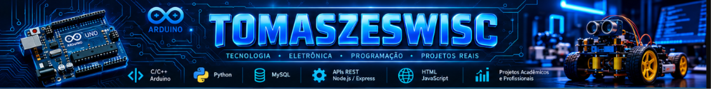

<p align="center"><a href="https://tomaszeswisc.github.io/tomaszeswisc/"></a></p>

<p align="center"><b>⚡ <a href="https://tomaszeswisc.github.io/tomaszeswisc/">Explorar o dashboard interativo</a></b> · <a href="https://github.com/tomaszeswisc/DS-Eletroeletronica#-catálogo-de-projetos">14 projetos Arduino</a></p>

<p align="center">
</p>

<h1 align="center">Olá, eu sou Hilton Elias 👋</h1>

<p align="center">
  <b>Software Developer • Educator • Researcher</b><br>
  Desenvolvimento de Sistemas • Automação • IoT • Robótica • Pesquisa
</p>

<p align="center">
  
</p>

<p align="center">
  <a href="#-sobre-mim">Sobre mim</a> ·
  <a href="#%EF%B8%8F-tecnologias--ferramentas">Tecnologias</a> ·
  <a href="#-projetos-em-destaque">Projetos</a> ·
  <a href="#-estat%C3%ADsticas">Estatísticas</a> ·
  <a href="#-pac-man-nas-contribui%C3%A7%C3%B5es">Pac-Man</a> ·
  <a href="#-onde-me-encontrar">Contato</a>
</p>

---

## 👨‍💻 Sobre mim

- 🚀 CEO da **HE Technology Solutions**
- 👨‍🏫 Instrutor de cursos técnicos nas áreas de **Informática para Internet, Desenvolvimento de Sistemas e Desenvolvimento Mobile**
- 🎓 **Mestrando em Engenharia Elétrica**
- 🤖 Atuação em **automação, robótica educacional, impressão 3D e eletrônica**
- 💻 Interesse em **desenvolvimento full stack, sistemas embarcados, IoT e tecnologia educacional**
- 🔬 Pesquisador em soluções com **microcontroladores, sensores e análise de dados**

---

## 🛠️ Tecnologias & Ferramentas

### 💻 Linguagens
<p>
  
  
  
  
  
</p>

### ⚙️ Frameworks, Plataformas & Ferramentas
<p>
  
  
  
  
  
  
  
  
  <img src="https://img.shields.io/badge/Wokwi-1A1A1A?style=for-the-badge&logo=data%3Aimage%2Fsvg%2Bxml%3Bbase64%2CPHN2ZyB4bWxucz0iaHR0cDovL3d3dy53My5vcmcvMjAwMC9zdmciIHZpZXdCb3g9IjAgMCAxOS44MTYgMTYuNDA2Ij48cGF0aCBmaWxsPSIjZmZmIiBkPSJNIDE3LjQzMTIzOCAwLjAwMDkwMTQwMDk3IEMgMTUuOTkyOTMzIDAuMDI0MDEyMDUgMTQuOTM4NjM0IDEuNTUwMzk2MyAxNS42NzMxOCAzLjA3NDE0NDggQyAxNi4wODYxNzkgMy45MzAxNDQgMTYuMDE3MTA1IDQuMjU4OTU1NSAxNC41NzcxMDYgOC4zMzY5NTE1IEMgMTQuMTQ0MTM5IDkuNTY4NjQxMyAxMy44Mzk3ODkgMTAuMzk2MjUxIDEzLjYyNjI0NiAxMC45NTg1MzYgQyAxMy4yNzQ4MDMgMTAuNTQ3NjY5IDEyLjk4Nzk2OCA5Ljc5NDY4NzggMTIuMzYwMTU0IDcuOTg1MDI5NyBDIDExLjQwNzE1NSA1LjIzMjAzMjQgMTEuMzUwOSA0Ljg2OTA1NzIgMTEuNzY2OSA0LjExOTA1NzkgQyAxMi43MjI4OTkgMi40MDAwNTk2IDExLjIzOTkyMSAwLjQ5Njc3NTE1IDkuMzQ4OTIzMyAxLjAxMzc3NDYgQyA3LjM0MTkyNTMgMS41NjE3NzQxIDcuMTkxMDc1OSA0LjA2NTE0MTYgOS4xMDcwNzQgNS4wMTUxNDA3IEMgOS44NzEwOTU1IDUuMzkyOTUzNSAxMC4wODU3NzQgNS43MjI5MjE0IDEwLjg3MDgxNyA3Ljk3ODMxMTYgQyA5LjcyNzA4NjMgOC43MTgxMjc2IDguMzA5NDQ1IDEwLjAxODg5MyA3LjQyMTg4MDMgMTAuODU5ODMzIEMgNi44NjA2MDM0IDExLjM5MTExOCA2LjU4MTIyMTMgMTEuNjg3MTgxIDYuMzI3MzU3MSAxMS44NDg5MzQgQyA1LjY5MjI4NyAxMS40OTkxNTcgNS40NzQyNzgzIDExLjAxNTA3OSA0LjYwNzAyMjkgOC41MTUyMzc4IEMgMy42NTQwMjM4IDUuNzYyMjQwNiAzLjU5Nzc2OSA1LjM5ODc0ODUgNC4wMTM3Njg2IDQuNjQ4NzQ5MyBDIDQuOTY5NzY3NiAyLjkyOTc1MSAzLjQ4Nzc5MDIgMS4wMjY5ODMzIDEuNTk1NzkyMSAxLjU0Mzk4MjggQyAtMC40MTEyMDU4OCAyLjA5MTk4MjIgLTAuNTYyMDU1MjkgNC41OTQ4MzMgMS4zNTM5NDI4IDUuNTQ0ODMyIEMgMi4xNzI5NDIgNS45NDk4MzE2IDIuMzUyMjU1MSA2LjI2OTk3MjcgMy4yODkyNTQxIDguOTk5OTcgQyA0LjE1Nzg2ODkgMTEuNTI4MjA5IDQuMjY1NzEwNCAxMi4wMzE3OTggMy45NDUwMzc5IDEyLjY5Nzk5MSBDIDMuMDU0MzY5NCAxMy42NTE5NzcgMy4xMTg2NTAyIDE1LjM4MDA1IDQuNTQyOTQzMiAxNi4yMTQxMDggQyA1LjIxOTk0MjUgMTYuNjEwMTA4IDYuMjI2OTEzMSAxNi4zNzk4NTkgNy4wMDY5MTIzIDE1LjY1MTg2IEMgNy4xMjU3NTQgMTUuNTQwNzY5IDcuMjIyMjgzNCAxNS40MzI5NTcgNy4yOTk5MjIxIDE1LjMyMTY0MyBDIDcuMzkxNDcyNCAxNS4yMjIxNzcgNy40NzMwNTcgMTUuMTEzODcyIDcuNTQwMjIxMSAxNC45OTYwNzYgQyA3Ljg5ODk4MzkgMTQuMzY3Mjc3IDcuOTI5MzQ2NyAxMy42Nzk1NTMgNy42ODU0MzQgMTMuMDk2OTM5IEMgNy44MjI5NzA0IDEyLjc3MDc2OCA4LjA2OTM3MyAxMi40MTk5NjcgOC40NzYwOTUzIDExLjkyMzg2NiBDIDkuMTMyMjk2NyAxMS4xMjI3OTkgMTAuNDg3MTcxIDEwLjAyMDAzNyAxMS40MTQ5NzggOS41NzkyNzE1IEMgMTEuOTc1NTg0IDExLjI5OTUyMSAxMS45NjYwNjUgMTEuNjc5NTg1IDExLjYyNDc4NyAxMi4zMDk4OTUgQyAxMS4xNzk3ODggMTMuMTMwODk0IDExLjMxNTE4NyAxNC4yNTYwMSAxMS45NDUxODYgMTQuOTk0MDA5IEMgMTIuNzI3MTg1IDE1LjkwNzAwOCAxNC42NDI4MzYgMTUuNjA1ODY3IDE1LjI5MjgzNSAxNC40NjU4NjggQyAxNS41MTMwNDkgMTQuMDc5OTAzIDE1LjYwOTY3MyAxMy42NzE3ODkgMTUuNTk1MTQ3IDEzLjI3OTM1OSBDIDE1LjYxMjg2IDEzLjI0NDAzMSAxNS42MDcxNzYgMTMuMTgwMzk5IDE1LjU3ODYxIDEzLjA4NzEyIEMgMTUuNTE2Mjk5IDEyLjYxNDEgMTUuMjkwNTQgMTIuMTczOSAxNC45MjI4MjcgMTEuODM2NTMyIEMgMTQuOTc1Mzg5IDExLjUyMDA5MiAxNS4yNDY0NzggMTAuNzk1MjEzIDE1LjkzODgwMSA4Ljg3ODAxMTggQyAxNy4xNTI3OTkgNS41MTUwMTUyIDE3LjY1NDc0NyA0LjQ1NjEzNjUgMTguMTI0NzQ2IDQuMjYwMTM2NyBDIDE4LjQ1OTc0NiA0LjEyMDEzNjggMTkuMDE1MjE1IDMuNzMzODQ1MSAxOS4zNTYyMTQgMy40MDM4NDU0IEMgMTkuOTAzMjE0IDIuODczODQ1OSAxOS45MzIxMyAyLjY2NzAyNyAxOS42MDAxMzEgMS42ODQwMjggQyAxOS4yOTUxMzEgMC43NzkwMjg5IDE5LjA1ODAxMSAwLjQ5NDE3Mzg1IDE4LjM2NDAxMiAwLjE5NDE3NDE1IEMgMTguMDQ1MDEyIDAuMDU1OTg2Nzg5IDE3LjcyOTc1NCAtMC4wMDM4OTUxNDg4IDE3LjQzMTIzOCAwLjAwMDkwMTQwMDk3IHogTSAxNy43MTE4NDUgMS41MTQwMSBDIDE4LjA0OTA2NCAxLjUxMTkwMDYgMTguMjQ2MzM5IDEuNzUzOTAxMSAxOC4yNTA4MzkgMi4yMDM5MDA3IEMgMTguMjUzODM5IDIuNDUxOTAwNCAxOC4wNTc3NSAyLjczMzE5NSAxNy44MTY3NSAyLjgyOTE5NDkgQyAxNy4zNTM3NTEgMy4wMTIxOTQ3IDE2LjczMTc5NiAyLjUzMzc1NDMgMTYuODE2Nzk2IDIuMDYwNzU0OCBDIDE2Ljg0Mzc5NiAxLjkwNzc1NSAxNy4wNzQ5NTEgMS42OTg3NjA1IDE3LjMyOTk1MSAxLjU5ODc2MDYgQyAxNy40NzE0NTEgMS41NDI1MTA3IDE3LjU5OTQzOSAxLjUxNDcxMzEgMTcuNzExODQ1IDEuNTE0MDEgeiBNIDEwLjAwNzI5MSAyLjI4MDg5OTcgQyAxMC4wNzE4MjkgMi4yODE3Nzc0IDEwLjEzMjQwNCAyLjI5NTcwMjcgMTAuMTg1MDYgMi4zMjU4NTg5IEMgMTAuNTg5MDYgMi41NTU4NTg3IDEwLjcxMDg5NyAzLjQ0NDgwOTIgMTAuMzY0ODk3IDMuNjMzODA5IEwgMTAuMzY0ODk3IDMuNjMyNzc1NCBDIDEwLjAxMzg5OCAzLjgyNDc3NTIgOS4yMTc3NDM5IDMuMzk5MTY1MyA5LjIwNDc0MzkgMy4wMTMxNjU3IEMgOS4xOTIwODc2IDIuNjU5NjM0OCA5LjY1ODc4NDYgMi4yNzYxNjAyIDEwLjAwNzI5MSAyLjI4MDg5OTcgeiBNIDIuMjU0MTU5NyAyLjgxMDU5MTEgQyAyLjMxODY5NzkgMi44MTE0NzI2IDIuMzc5MjczMSAyLjgyNTkxMDggMi40MzE5MjkzIDIuODU2MDY3IEMgMi44MzU5Mjg5IDMuMDg2MDY2OCAyLjk1Nzc2NTYgMy45NzUwMTczIDIuNjExNzY2IDQuMTY0MDE3MSBDIDIuMjYwNzY2MyA0LjM1NTAxNjkgMS40NjUxMjk1IDMuOTI4ODIzMSAxLjQ1MjEyOTUgMy41NDE4MjM1IEMgMS40Mzk0NzMyIDMuMTg5MTM2NCAxLjkwNTY1MzQgMi44MDU4MzEgMi4yNTQxNTk3IDIuODEwNTkxMSB6IE0gMTMuMjAzNTI2IDEyLjc0ODExOCBDIDEzLjM1ODU0MiAxMi43MzczMzYgMTMuNTc1Mzg4IDEyLjc5MDgxNCAxMy43NTM4ODggMTIuODkyODE0IEMgMTQuMjgyNzcgMTMuMTk0NzQ2IDE0LjMyMTkxNCAxMy42MTEwMjQgMTMuODU3MjQzIDEzLjk5MDk1NSBDIDEzLjY2NDE4NiAxNC4xNDc3MTkgMTMuMzIzOTc5IDE0LjE3MTAwOSAxMy4wOTgxMDUgMTQuMDQxMDgxIEMgMTIuNjY2MTA1IDEzLjc5NTA4MiAxMi42NDk3ODMgMTMuMDExMTkxIDEzLjA3Mjc4MyAxMi43ODExOTEgQyAxMy4xMDcwMzMgMTIuNzYyNjkxIDEzLjE1MTg1NCAxMi43NTE3MTEgMTMuMjAzNTI2IDEyLjc0ODExOCB6IE0gNS40Njg5OTg3IDEzLjYxNTc3OCBDIDYuMDc3OTk4MSAxMy42MTU3NzggNi4zMTgwNzc4IDEzLjk1OTA5NiA2LjEwMzA3OCAxNC41MTkwOTYgQyA2LjEwMjQwOTUgMTQuNTIwODQgNi4xMDE2OTUzIDE0LjUyMjUzIDYuMTAxMDEwOSAxNC41MjQyNjMgQyA1LjkwNzMzNDQgMTQuNjc4Mzc1IDUuNTY5NDMxNCAxNC42OTk4ODYgNS4zNDQ5NzM0IDE0LjU3MDc3MyBDIDUuMDY0NDYzMSAxNC40MTEwMzggNC45NjA5MTIxIDE0LjAyNTMwOCA1LjAzNzQ5NCAxMy43MTA4NjQgQyA1LjE1NDU3NzEgMTMuNjUwNjcgNS4yOTkyNTUyIDEzLjYxNTc3OCA1LjQ2ODk5ODcgMTMuNjE1Nzc4IHogIi8%2BPC9zdmc%2B" alt="Wokwi" />

<img src="https://img.shields.io/badge/OrcaSlicer-009789?style=for-the-badge&logo=data%3Aimage%2Fsvg%2Bxml%3Bbase64%2CPHN2ZyBpZD0iYSIgeG1sbnM9Imh0dHA6Ly93d3cudzMub3JnLzIwMDAvc3ZnIiB3aWR0aD0iNDgwIiBoZWlnaHQ9IjQ4MCIgdmlld0JveD0iMCAwIDQ4MCA0ODAiPjxnIGlkPSJiIj48ZyBpZD0iYyI%2BPHJlY3QgeD0iMTY4Ljk3IiB5PSI4MC41NCIgd2lkdGg9IjE0Mi4wNSIgaGVpZ2h0PSIxNDIuMDUiIHJ4PSIxNyIgcnk9IjE3IiBzdHlsZT0iZmlsbDojZTllOWU5OyIvPjwvZz48L2c%2BPGcgaWQ9ImQiPjxwYXRoIGlkPSJlIiBkPSJNMTk5LjY5LDE5Mi4zMWM3LjkxLDcuOSwxOC43OSwxMi44LDMwLjgxLDEyLjg1LDI0LjMzLjEsNDQuMjUtMTkuOTMsNDQuMTYtNDQuNC0uMDUtMTIuMDktNC45Mi0yMy4wMy0xMi43OC0zMC45OGwtNjIuMTksNjIuNTNaIiBzdHlsZT0iZmlsbDojMjkyODI2OyIvPjwvZz48ZyBpZD0iZiI%2BPHBhdGggaWQ9ImciIGQ9Ik0yNjEuODgsMTI5Ljc4bC02Mi4xOSw2Mi41M3MuMDkuMDkuMTMuMTNjMjEuNzktMTEuMTEsNTEuNjItMzAuNjQsNzIuMDgtNDYuOTEtMi4yMS01Ljk2LTUuNjYtMTEuMzItMTAuMDMtMTUuNzUiIHN0eWxlPSJmaWxsOiMwMDk3ODk7Ii8%2BPC9nPjxnIGlkPSJoIj48cGF0aCBpZD0iaSIgZD0iTTI0OS43Miw5Ny45OGMtMjQuMjksMC00My45NywxOS44LTQzLjk3LDQ0LjIyLDAsMTIuMTYsNC44OCwyMy4xNywxMi43OCwzMS4xNmw2Mi4xOS02Mi41M2MtNy45NS03Ljk0LTE4LjktMTIuODUtMzAuOTktMTIuODUiIHN0eWxlPSJmaWxsOiMyOTI4MjY7Ii8%2BPC9nPjxnIGlkPSJqIj48cGF0aCBpZD0iayIgZD0iTTI0OS43Miw5Ny45OGMtOC40MSwwLTE2LjI3LDIuMzgtMjIuOTUsNi41LTMuNTgtLjk0LTguMDItMS42OS0xMy4xMi0xLjY1LTguODkuMDYtMTYuMTIsMi40Ni0yMS4wNCw0LjcxLTEuMjIuNTYtMS4wMiwyLjM3LjI5LDIuNjQsMy4yMy42OCw3LjQ5LDIuMTIsMTEuNyw1LjIzLDIuNjYsMS45Niw0LjY4LDQuMTQsNi4yMSw2LjE3LTMuMjMsNi4xNi01LjA3LDEzLjE3LTUuMDcsMjAuNjIsMCw0LjQ0LjY1LDguNzMsMS44NywxMi43OCwxLjg2LTQuMTIsMy44MS02Ljg4LDQuNDQtNy43NCw0LjA0LTUuNTUsOC4zMS04LjQ0LDE0LjYyLTEyLjcsNC42NS0zLjE0LDExLjEtNi44MywyOS42NS0xNC40NSwwLDAsNS44LTEuNjMsMTMuNTgtNi4yNiwzLjEtMS44NCw1LjQ2LTMuNTgsNi4yMS02LjMxLjA1LS4xOS4xLS4zOC4xNC0uNTctNy4zOC01LjYyLTE2LjU3LTguOTYtMjYuNTMtOC45NiIgc3R5bGU9ImZpbGw6IzI2MjUyMzsiLz48L2c%2BPGcgaWQ9ImwiPjxwYXRoIGlkPSJtIiBkPSJNMjU3LjA3LDExMi44NGMxLjYxLDIuODUtMS42Miw3Ljc2LTcuMjEsMTAuOTYtNS42LDMuMi0xMS40NCwzLjQ4LTEzLjA1LjYzLTEuNjEtMi44NSwxLjYyLTcuNzYsNy4yMS0xMC45Niw1LjYtMy4yLDExLjQ0LTMuNDgsMTMuMDUtLjYzIiBzdHlsZT0iZmlsbDojZmZmOyIvPjwvZz48cGF0aCBkPSJNMjI1Ljc1LDI3OC43N2MtMS4yMSwwLTIuMi45OC0yLjIsMi4ydjIxLjk5YzAsMS4yMS45OCwyLjIsMi4yLDIuMnMyLjItLjk4LDIuMi0yLjJ2LTIxLjk5YzAtMS4yMS0uOTgtMi4yLTIuMi0yLjJaIiBzdHlsZT0iZmlsbDojOTQ5NDk0OyIvPjxwYXRoIGQ9Ik0yODMuNDQsMjc4Ljc3aC01LjI2Yy03LjI3LDAtMTMuMTksNS45Mi0xMy4xOSwxMy4xOXM1LjkyLDEzLjE5LDEzLjE5LDEzLjE5aDUuMjZjMS4yMSwwLDIuMi0uOTgsMi4yLTIuMnMtLjk4LTIuMi0yLjItMi4yaC01LjI2Yy00Ljg1LDAtOC44LTMuOTUtOC44LTguOHMzLjk1LTguOCw4LjgtOC44aDUuMjZjMS4yMSwwLDIuMi0uOTgsMi4yLTIuMnMtLjk4LTIuMi0yLjItMi4yWiIgc3R5bGU9ImZpbGw6Izk0OTQ5NDsiLz48cGF0aCBkPSJNMjgzLjQ0LDI4OS43N2gtNi4zOWMtMS4yMSwwLTIuMi45OC0yLjIsMi4ycy45OCwyLjIsMi4yLDIuMmg2LjM5YzEuMjEsMCwyLjItLjk4LDIuMi0yLjJzLS45OC0yLjItMi4yLTIuMloiIHN0eWxlPSJmaWxsOiM5NDk0OTQ7Ii8%2BPHBhdGggZD0iTTE4MS44MSwzMDUuMTZoLTEwLjY1Yy0xLjIxLDAtMi4xOS0uOTgtMi4xOS0yLjE5cy45OC0yLjE5LDIuMTktMi4xOWgxMC42NWMxLjgzLDAsMy4zMi0xLjQ5LDMuMzItMy4zMnMtMS40OS0zLjMyLTMuMzItMy4zMmgtNS4xNWMtNC4yNCwwLTcuNjktMy40NS03LjY5LTcuNjlzMy40NS03LjY5LDcuNjktNy42OWg4LjcxYzEuMjEsMCwyLjE5Ljk4LDIuMTksMi4xOXMtLjk4LDIuMTktMi4xOSwyLjE5aC04LjcxYy0xLjgzLDAtMy4zMiwxLjQ5LTMuMzIsMy4zMnMxLjQ5LDMuMzIsMy4zMiwzLjMyaDUuMTVjNC4yNCwwLDcuNjksMy40NSw3LjY5LDcuNjlzLTMuNDUsNy42OS03LjY5LDcuNjlaIiBzdHlsZT0iZmlsbDojOTQ5NDk0OyIvPjxwYXRoIGQ9Ik0yNTMuNzcsMjk5LjMxYy0xLjc4LDEuMTctNCwxLjcyLTYuMzYsMS4zMi0zLjU3LS42LTYuNDYtMy40NC03LjEyLTctMS4wMy01LjU4LDMuMjQtMTAuNDcsOC42NC0xMC40NywxLjc4LDAsMy40NC41Myw0LjgzLDEuNDUuODguNTgsMi4wNC40OCwyLjc4LS4yNmgwYy45Ny0uOTcuODQtMi42LS4yOS0zLjM2LTIuNTMtMS43LTUuNjgtMi41NC05LjA0LTIuMTEtNS45NC43Ni0xMC43MSw1LjYtMTEuMzksMTEuNTUtLjksNy45Niw1LjMzLDE0LjczLDEzLjExLDE0LjczLDIuNjcsMCw1LjE1LS44LDcuMjMtMi4xNiwxLjE4LS43OCwxLjM4LTIuNDIuMzgtMy40MmgwYy0uNzQtLjc0LTEuOS0uODUtMi43Ny0uMjdaIiBzdHlsZT0iZmlsbDojOTQ5NDk0OyIvPjxwYXRoIGQ9Ik0yMTMuNTUsMzAwLjc2aC02LjM1Yy0zLjAzLDAtNS41LTIuNDctNS41LTUuNXYtMTQuMjljMC0xLjIxLS45OC0yLjItMi4yLTIuMnMtMi4yLjk4LTIuMiwyLjJ2MTQuMjljMCw1LjQ2LDQuNDQsOS45LDkuOSw5LjloNi4zNWMxLjIxLDAsMi4yLS45OCwyLjItMi4ycy0uOTgtMi4yLTIuMi0yLjJaIiBzdHlsZT0iZmlsbDojOTQ5NDk0OyIvPjxwYXRoIGQ9Ik0zMDguODMsMjgzLjE3aC0yLjJjLTQuODIsMC04Ljc1LDMuOS04Ljc5LDguNzJ2MTEuMDdjMCwxLjIxLS45OCwyLjItMi4yLDIuMnMtMi4yLS45OC0yLjItMi4ydi0xMS4wN2MuMDQtNy4yNCw1Ljk0LTEzLjEyLDEzLjE5LTEzLjEyaDIuMmMxLjIxLDAsMi4yLjk4LDIuMiwyLjJzLS45OCwyLjItMi4yLDIuMloiIHN0eWxlPSJmaWxsOiM5NDk0OTQ7Ii8%2BPHBhdGggZD0iTTE4Ni42NSwyMzguNDVjNi43NSwwLDEyLjI0LDUuNDksMTIuMjQsMTIuMjRzLTUuNDksMTIuMjQtMTIuMjQsMTIuMjQtMTIuMjQtNS40OS0xMi4yNC0xMi4yNCw1LjQ5LTEyLjI0LDEyLjI0LTEyLjI0TTE4Ni42NSwyMzMuMDFjLTkuNzYsMC0xNy42OCw3LjkxLTE3LjY4LDE3LjY4czcuOTEsMTcuNjgsMTcuNjgsMTcuNjgsMTcuNjgtNy45MSwxNy42OC0xNy42OC03LjkxLTE3LjY4LTE3LjY4LTE3LjY4aDBaIiBzdHlsZT0iZmlsbDojMDA5Nzg5OyIvPjxwYXRoIGQ9Ik0zMDguMzEsMjMzLjAxYy0xLjUsMC0yLjcyLDEuMjItMi43MiwyLjcydjIuMjJjLTMuMTgtMy4wNS03LjQ4LTQuOTQtMTIuMjQtNC45NC05Ljc2LDAtMTcuNjgsNy45MS0xNy42OCwxNy42OHM3LjkxLDE3LjY4LDE3LjY4LDE3LjY4YzQuNzUsMCw5LjA2LTEuODksMTIuMjQtNC45NHYyLjIyYzAsMS41LDEuMjIsMi43MiwyLjcyLDIuNzJzMi43Mi0xLjIyLDIuNzItMi43MnYtMjkuOTFjMC0xLjUtMS4yMi0yLjcyLTIuNzItMi43MlpNMjkzLjM1LDI2Mi45MmMtNi43NSwwLTEyLjI0LTUuNDktMTIuMjQtMTIuMjRzNS40OS0xMi4yNCwxMi4yNC0xMi4yNCwxMi4yNCw1LjQ5LDEyLjI0LDEyLjI0LTUuNDksMTIuMjQtMTIuMjQsMTIuMjRaIiBzdHlsZT0iZmlsbDojMDA5Nzg5OyIvPjxwYXRoIGQ9Ik0yMzIuNTIsMjMzLjAxaC0yLjcyYy05Ljc2LDAtMTcuNjgsNy45MS0xNy42OCwxNy42OHYxNC45NmMwLDEuNSwxLjIyLDIuNzIsMi43MiwyLjcyczIuNzItMS4yMiwyLjcyLTIuNzJ2LTE0Ljk2YzAtNi43NSw1LjQ5LTEyLjI0LDEyLjI0LTEyLjI0aDBzMi43MiwwLDIuNzIsMGMxLjUsMCwyLjcyLTEuMjIsMi43Mi0yLjcycy0xLjIyLTIuNzItMi43Mi0yLjcyWiIgc3R5bGU9ImZpbGw6IzAwOTc4OTsiLz48cGF0aCBkPSJNMjY1LjExLDI2MC43N2MtMi4zNywxLjYzLTUuMzQsMi40NS04LjUxLDIuMDQtNS41MS0uNy05Ljk0LTUuMTktMTAuNTYtMTAuNzEtLjg0LTcuMzgsNC45NC0xMy42NiwxMi4xNi0xMy42NiwyLjU1LDAsNC45MS43OCw2Ljg3LDIuMTIsMS4xLjc1LDIuNTcuNjcsMy41Mi0uMjhoMGMxLjIyLTEuMjIuOTktMy4yMy0uNDMtNC4yMS0zLjI5LTIuMjUtNy4zOS0zLjQyLTExLjc3LTIuOTgtOC4xOS44MS0xNC44NCw3LjM3LTE1Ljc2LDE1LjU1LTEuMTksMTAuNjcsNy4xMywxOS43MSwxNy41NiwxOS43MSwzLjcxLDAsNy4xNS0xLjE0LDEwLTMuMSwxLjQxLS45NywxLjYxLTIuOTguNC00LjE5aDBjLS45My0uOTMtMi4zOS0xLjA1LTMuNDgtLjNaIiBzdHlsZT0iZmlsbDojMDA5Nzg5OyIvPjwvc3ZnPg%3D%3D" alt="OrcaSlicer" />

```
</p>

### 🗄️ Banco de Dados
<p>
  
  
  
</p>

---

## 📌 Áreas de atuação

- 💻 Desenvolvimento Web e Full Stack
- 🤖 Automação, Robótica e IoT
- 🔌 Sistemas Embarcados e Microcontroladores
- 🧠 Pesquisa e Desenvolvimento
- 📚 Tecnologia Educacional
- 🖨️ Modelagem e Impressão 3D

---

## 🚀 Projetos em destaque

### 💰 [SENAI Finance](https://github.com/tomaszeswisc/senai-finance)
Projeto educacional de interface web para um sistema de controle financeiro, com páginas de apresentação e login. **HTML5 e CSS3**.

### 🤖 [DS-Eletroeletronica — Arduino, Wokwi e PlatformIO](https://github.com/tomaszeswisc/DS-Eletroeletronica)
Laboratório com **14 projetos catalogados** de circuitos e sistemas embarcados. Exemplos com Arduino Uno, sensores, LEDs, botões, buzzer e servomotores. **C/C++, Wokwi, VS Code e PlatformIO**.

### 🔐 [API Finance](https://github.com/tomaszeswisc/apiFinance)
Backend de sistema financeiro com rotas de autenticação e transações, usando **Node.js, Express e MySQL**. *Em revisão de segurança.*

### 📦 [API Inventory](https://github.com/tomaszeswisc/apiInventory)
API de gerenciamento de produtos com **Node.js, Express e MySQL**. *Em revisão de segurança.*

### 🔄 [API Troca Tudo](https://github.com/tomaszeswisc/api-troca-tudo)
Aplicação com rotas de login e produtos utilizando **Express e MySQL**. *Em revisão de segurança.*

### 🛒 [SPA Quitanda](https://github.com/tomaszeswisc/spa_quitanda)
Projeto com API para consulta e cadastro de produtos usando **Express e MySQL**. *Em revisão de segurança.*

---

## 📊 Estatísticas

<p align="center">
  
  
</p>

---

## 🧠 Contribuições

<p align="center">
  
</p>

---

## 🎮 Pac-Man nas contribuições

<p align="center">
  
</p>

---

## 📫 Onde me encontrar

<p>
  <a href="https://www.linkedin.com/in/hilton-elias/" target="_blank">
    
  </a>
  <a href="mailto:tomaszeswisc@gmail.com" target="_blank">
    
  </a>
  <a href="https://github.com/tomaszeswisc" target="_blank">
    
  </a>
</p>

---

<p align="center">
  <i>“Tecnologia, educação e inovação caminhando juntas.”</i>
</p>
